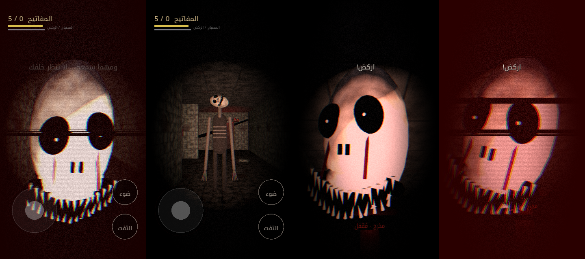

# لا تنظر خلفك — لعبة رعب للهاتف (Godot 4)



لعبة رعب ثلاثية الأبعاد بمنظور الشخص الأول، مصممة للهاتف بالوضع **العمودي** (720×1280).
كل شيء مولّد برمجياً: المتاهة، الإضاءة، النسيج، الكائن، **وجميع الأصوات** — لا توجد أي ملفات صوت أو نماذج خارجية.

## القصة
الجناح رقم ٧ في مستشفى مهجور أُغلق منذ ثلاثين عاماً. استيقظتَ بداخله.
اجمع **٥ مفاتيح** صدئة، ثم عد إلى **باب المخرج** قبل أن يجدك.

## التحكم
| المنطقة | الوظيفة |
|---|---|
| **يسار الشاشة** | عصا تحكم عائمة تظهر حيث تلمس — للحركة. اسحبها بعيداً للركض (يستهلك التحمّل) |
| **يمين الشاشة** | اسحب للنظر حولك |
| زر **ضوء** | تشغيل/إطفاء المصباح (المصباح يكشفك له من مسافة أبعد!) |
| زر **التفت** | استدارة سريعة 180° |

للتجربة على الحاسوب: `WASD` للحركة، `Shift` للركض، انقر لالتقاط الفأرة ثم حركها للنظر، `F` للمصباح، `Q` للالتفات.

## ما الذي يجعلها مخيفة
- **كائن يطاردك بذكاء**: يتجوّل ويقترب، يطاردك عندما يراك، يبحث في آخر مكان رآك فيه، و**ينتقل خفيةً إلى ممر خلفك** عندما يفقد أثرك. يزداد سرعةً وعدوانية مع كل مفتاح.
- **مخرج الرعب (Scare Director)** يطلق أحداثاً عشوائية:
  - ظلّ يقف في آخر الممر… ويختفي لحظة تنظر إليه
  - همسٌ خلفك — **إن التفتّ، تجد وجهه أمامك مباشرة**
  - انطفاء المصباح وصوت تنفّس بجانبك… وعندما يعود الضوء يكون واقفاً أمامك
  - خطوات تقترب من خلفك ثم صمت…
  - شيء يعبر الممر بسرعة أمامك
  - ارتطامات مفاجئة، تشويش للشاشة ورسائل «أنا أراك»
- **دمى** تدير رؤوسها نحوك عندما لا تنظر إليها… وتقترب
- كتابات بالدم على الجدران، أضواء ترتعش بقوة عند اقترابه
- نبض قلب يتسارع، اهتزاز الهاتف، تأثيرات شاشة (حبيبات، تشويه، وميض أحمر)
- مشهد **قفزة رعب** عند الإمساك بك… ونهاية مفاجئة حتى عندما تنجو

> العب بسماعات الرأس، في الظلام.

## التشغيل
1. ثبّت [Godot 4.3](https://godotengine.org/download) أو أحدث.
2. افتح المجلد `horror-game/` (ملف `project.godot`) واضغط F5.

## التصدير إلى أندرويد
1. من Godot: `Editor → Manage Export Templates` ثبّت قوالب التصدير.
2. اضبط مسار Android SDK ومفتاح التوقيع في `Editor Settings → Export → Android`.
3. `Project → Export` واختر الإعداد **Android** الجاهز (عمودي، ملء الشاشة، إذن الاهتزاز).

المحرّك يستخدم مُصيِّر **Compatibility (OpenGL ES 3)** ليعمل على أكبر عدد من الهواتف.

## بنية المشروع
```
scripts/game.gd            المتحكم الرئيسي: الواجهة، مخرج الرعب، النهايات
scripts/level.gd           توليد المتاهة/المستشفى، الأضواء، الدمى، الكتابات، المخرج
scripts/player.gd          اللاعب: الحركة، المصباح، البطارية، اهتزاز الكاميرا
scripts/monster.gd         ذكاء الكائن (A* على شبكة المتاهة)
scripts/creature.gd        نموذج الكائن ووجه القفزة المرعبة من أشكال أولية
scripts/touch_controls.gd  عصا التحكم يساراً + النظر يميناً + الأزرار
scripts/sfx.gd             توليد جميع الأصوات برمجياً
shaders/overlay.gdshader   تأثيرات الشاشة
tests/logic.tscn           اختبار آلي: جمع المفاتيح، المطاردة، النهايات
```

الخط: Noto Kufi Arabic (رخصة OFL — انظر `fonts/OFL.txt`).
